  

  
  
  

---

### 👋 Oi, eu sou o João

Sou **gerente de projetos** de formação e de ofício: cronograma, escopo, risco,
gente alinhada e entrega no prazo. Só que a curiosidade nunca me deixou parar no
quadro de tarefas. Em algum momento eu quis entender *como* as coisas eram
construídas, abri o editor e não fechei mais.

Hoje eu fico no meio do caminho entre os dois mundos, e é ali que eu gosto de estar:

- 🗂️ **Penso como PM:** começo pelo problema, pelo dono da decisão e pelo que conta como "pronto".
- 🛠️ **Construo como dev:** React, TypeScript, Firebase e muita regra de negócio com teste.
- 🔁 **Entrego aos poucos:** uma frente por vez, com changelog, backlog vivo e nada de "funciona na minha máquina".

### 🚀 O que estou construindo

Fundei a **JP Projects**, um ecossistema de produtos SaaS que conversam entre si
por um hub central. Cada produto resolve a rotina de um tipo de negócio:

| | Produto | Para quem |
|---|---|---|
| ✂️ | **Topete** | Barbearias: agenda, clientes e financeiro |
| ✦ | **Ciliare** | Lash designers: agenda e gestão |
| 🏭 | **Fábrica** | Indústrias: pedidos, produção e NF-e |
| 💰 | **JP Finance** | Finanças pessoais e de pequenos negócios |
| 🏋️ | **JP Fitness** | Personal trainers: treinos e alunos |
| 🎾 | **Arena** | Quadras e escolinhas: reservas e aulas |
| 🧭 | **Hub** | O console que liga tudo: clientes, cobrança, provisionamento e saúde dos sistemas |

> Os repositórios são privados: o código é dos produtos e dos clientes. Quer ver
> algo funcionando? Me chama que eu mostro.

### 🧰 Ferramentas do dia a dia

  

**Do lado da gestão:** PMO, metodologias ágeis, gestão de portfólio, indicadores e
o velho e bom "quem decide isso?".

### 🧠 Coisas que você talvez não saiba sobre mim

- Escrevo os nomes das funções em português quando o código é meu. `cobrarMensalidade()` me explica melhor do que `processPayment()`.
- Acredito que número que mente é pior que número nenhum, então todo dashboard que eu faço tem que bater com a fonte.
- Trato pair programming com IA como trato um time: escopo fechado, revisão crítica e ninguém publica sem eu ver.

### 📫 Vamos conversar

Gosta de produto, de gestão ou de código (ou dos três)? Me chama pelo site da
[JP Projects](https://jpproject.com.br).

  

